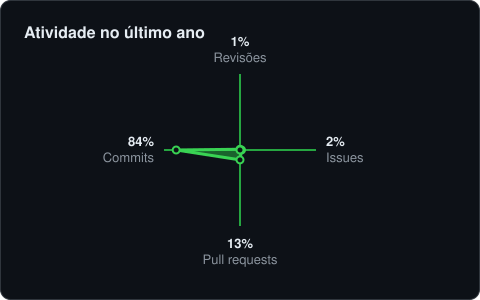
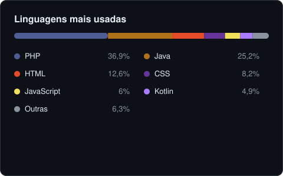

## Hi there, I'm Kauan Kawasaki

Desenvolvedor Backend em formação, com **Java e Spring Boot**, e base em dados com **Python e SQL**.
Estudante de Engenharia de Software na UEPA. Aberto a estágio em Backend e Dados.

[Portfólio](https://kauan-kawasaki.pages.dev) · [LinkedIn](https://www.linkedin.com/in/kauan-kawasaki) · [E-mail](mailto:kauankawasaki01@gmail.com)

### Projetos

| Projeto | O que faz | Stack |
| --- | --- | --- |
| [pipeline-indicadores-bcb](https://github.com/KAUAN-KAWASAKI/pipeline-indicadores-bcb) | Coleta Selic, IPCA e dólar do Banco Central todo dia e grava no MySQL com upsert | Python · pandas · MySQL · GitHub Actions |
| [api-indicadores-bcb](https://github.com/KAUAN-KAWASAKI/api-indicadores-bcb) | API REST sobre esses dados, com filtro por período e erros ProblemDetail | Java · Spring Boot · JPA · JUnit · Docker |
| [focinho](https://github.com/KAUAN-KAWASAKI/focinho) | Agenda de banho e tosa para pet shops que recusa horários sobrepostos | Java 21 · Spring Boot · Spring Security · MySQL |
| [analisador-gastos](https://github.com/KAUAN-KAWASAKI/analisador-gastos) | Lê extratos em CSV, classifica os gastos e gera gráficos | Python · pandas · Matplotlib · pytest |
| [delivery-patterns-api](https://github.com/KAUAN-KAWASAKI/delivery-patterns-api) | API de pedidos com Strategy, Chain of Responsibility e Facade | Java 21 · Spring Boot · JPA · JUnit |

**Em breve:** Compensa (comparador do custo de uma lista de compras entre mercados) e Alertas de indicadores (aviso por e-mail quando a Selic ou o dólar passam de um limite).

### Stack

`Java` `Spring Boot` `Python` `pandas` `SQL` `MySQL` `Docker` `Git` `GitHub Actions`

### Estatísticas

  
  

